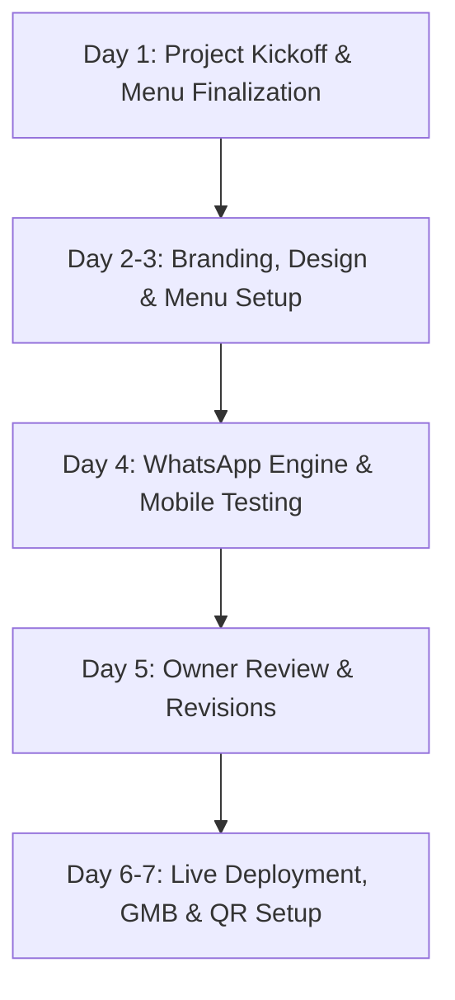

# 🍽️ Business Outreach & Digital Growth Proposal
## Grand Spicy — Premium North Indian & Mughlai Restaurant
> **Target:** Owner / General Manager — Grand Spicy  
> **Location:** Mangal Talab Road, Near Bal Lila Gurudwara, Patna City, Patna, Bihar 800008  
> **Prepared by:** Local Web & Digital Growth Consultant, Patna City  
> **Date:** September 2026  
> **Confidentiality:** Exclusively prepared for Grand Spicy

---

## 1. 🏢 Business Profile & Current Digital Footprint

| Attribute | Current Status | Digital Growth Potential |
| :--- | :--- | :--- |
| **Business Name** | **Grand Spicy** | High brand recall among foodies in Patna City |
| **Category** | North Indian & Mughlai Restaurant | High demand cuisine for family dine-in & home delivery |
| **Location** | Mangal Talab Road, Near Bal Lila Gurudwara, Patna City | Prime landmark location with high footfall & tourist traffic |
| **Contact Phone** | **+91 72776 53081** | Ready for WhatsApp direct order automation |
| **Reputation & Rating** | **⭐ 4.1 / 5 Stars** (120+ verified Google reviews) | Exceptional social proof; needs to be showcased front & center |
| **Price Point** | ~₹350 for two | Highly attractive value proposition for families & youth |
| **Key Strengths** | Rich Mughlai flavors, affordable pricing, beautiful decor & ambiance, vegetarian & non-vegetarian variety | Strong visual appeal that converts quickly when shown online |
| **Current Online Presence** | Google Maps & JustDial listing only | **No official website, no direct ordering portal, no active social media** |

---

## 2. 🚨 Why Grand Spicy Urgently Needs a Dedicated Website

A Google Business listing or third-party directory is no longer enough to dominate the Patna City dining market. Grand Spicy is currently missing out on massive revenue every single day due to these critical pain points:

### 1. 💸 Stop Leaking 20% to 30% Margin to Swiggy & Zomato
* **The Reality:** Food aggregator apps charge between **22% and 30% commission + GST** on every single order. On a ₹1,000 order, you lose ₹250 to ₹300 just for delivery aggregation.
* **The Solution:** With your own branded website, regular local customers from Patna City, Chowk, and Mangal Talab can place orders directly to your restaurant's WhatsApp with **ZERO commission**, keeping 100% of the profits in your pocket.

### 2. 🔍 Google Searches in Patna City Are Going to Competitors
* Every week, hundreds of locals, students, pilgrims visiting Gurudwara Bal Lila, and visitors search:
  * *"Best Mughlai restaurant in Patna City"*
  * *"Top North Indian food near Mangal Talab"*
  * *"Family dinner places near Bal Lila Gurudwara"*
* Without a search-engine-optimized website, Google displays your competitors or generic aggregator listings rather than directing them straight to Grand Spicy's table reservation desk.

### 3. 📖 Customers Demand a Clear, Visual Digital Menu with Prices
* When customers want to plan a family gathering, party, or dinner, they want to see what dishes you offer and how much they cost.
* Today, people have to call or guess your prices. A crisp, mobile-friendly digital menu featuring your **Mughlai Chicken Biryani, Butter Chicken, Paneer Tikka Masala, and Dal Makhani** builds instant craving and increases order sizes.

### 4. ✨ Your Beautiful Ambiance & Decor Is Hidden from New Customers
* Customer reviews consistently praise Grand Spicy’s **"beautiful decor"** and **"nice ambiance"**.
* But someone sitting at home or visiting Patna City doesn't know that! An interactive photo gallery showcasing your interior, comfortable seating, and steaming food turns casual searchers into confirmed dine-in visitors.

### 5. 📱 Building Your Own Customer Asset (Database)
* On Swiggy or Zomato, **you do not own your customer data**; the platform does.
* With your own website and WhatsApp channel, you collect customer numbers legitimately. You can send festive greetings, weekend specials, and loyalty discounts directly to your most loyal patrons.

---

## 3. 🚀 What We've Already Built: The Live Interactive Demo

We don't just pitch promises — we have already invested the effort to build a **fully functional, custom demo website** tailored specifically for Grand Spicy!

### 🌟 Key Highlights of the Demo Website Built for Grand Spicy:
* **Royal Mughlai Brand Aesthetic:** Styled in premium imperial gold (`#d4af37`), deep royal maroon (`#5c0f16`), and rich dark velvet tones that evoke authentic Mughlai royalty.
* **100% Mobile Responsive:** Loads blazing fast on Jio, Airtel, and Wi-Fi networks across Android and iPhone devices.
* **Curated Digital Menu:** Includes signature dishes categorized with clear Veg/Non-Veg indicators and pricing:
  * *Mughlai Chicken Biryani (₹180)*
  * *Butter Chicken (₹190)*
  * *Mutton Rogan Josh (₹220)*
  * *Paneer Tikka Masala (₹150)*
  * *Dal Makhani (₹120)*
  * *Garlic Naan (₹40)*
* **Direct 1-Click WhatsApp Ordering & Inquiry:** Integrated with Grand Spicy's phone number (`+91 72776 53081`) with pre-written messages so hungry patrons can order in two taps.
* **Visual Gallery & Atmosphere Showcase:** Highlighting dine-in excellence, tandoori delicacies, and family ambiance.
* **Customer Reviews Showcase:** Highlighting Grand Spicy's stellar 4.1⭐ rating and positive diner feedback to build trust instantly.
* **Interactive Google Map:** Embedded map directing customers right to your doorstep near Bal Lila Gurudwara.

> 📍 **Demo Files Location:** `scratch/patna-business-websites/01-grand-spicy/index.html`  
> *(Ready to be published instantly under a custom domain like `www.grandspicypatna.com`)*

---

## 4. 💎 Subscription & Investment Packages

We offer three flexible tiers designed specifically for the restaurant industry in Patna City. No hidden fees, no technical headaches.

```
+-------------------------------------------------------------------------------+
|                            SUBSCRIPTION TIERS                                 |
+-----------------------+-------------------------------+-----------------------+
|      🌿 STARTER       |        ⭐ PROFESSIONAL        |       👑 PREMIUM      |
|    ₹7,000 - ₹10,000   |       ₹15,000 - ₹22,000       |   ₹30,000 - ₹50,000   |
|   (Essential Presence)|     (Most Popular / Growth)   |     (Full Domination) |
+-----------------------+-------------------------------+-----------------------+
| • 1-Page Fast Site    | • Multi-Section Complete Site | • Bespoke Luxury Site |
| • Up to 15 Menu Items | • Full Categorized Menu       | • WhatsApp Cart Engine|
| • Click-to-WhatsApp   | • 20-Photo Food/Ambiance Gal. | • Table Booking Portal|
| • Google Maps Embed   | • Google Business Optimization| • QR Table Standees   |
| • 15 Days Support     | • 30 Days Priority Support    | • 60 Days VIP Support |
+-----------------------+-------------------------------+-----------------------+
```

### 🌿 Plan 1: Starter Tier — *Digital Essentials*
**Price:** ₹7,000 – ₹10,000 (One-time Setup)  
**Target:** Perfect for establishing a clean, legitimate online presence quickly.

* **Single-Page High-Speed Website:** Sleek, modern, and mobile-first.
* **Signature Menu Display:** Showcase up to 15 bestsellers with prices and descriptions.
* **Direct WhatsApp Call-to-Action:** Direct links to phone and WhatsApp chat for easy ordering and inquiries.
* **Google Maps Embed:** Direct driving directions to Mangal Talab Road.
* **Basic On-Page SEO:** Configured for searches like *"Grand Spicy Patna City"* and *"Grand Spicy contact number"*.
* **15 Days Warranty & Tech Support:** Ensuring everything runs smoothly post-launch.

---

### ⭐ Plan 2: Professional Tier — *Restaurant Growth Engine*
**Price:** ₹15,000 – ₹22,000 (One-time Setup) — **RECOMMENDED FOR GRAND SPICY**  
**Target:** Designed to attract high footfall, capture direct takeaway orders, and save heavy commissions.

* **Multi-Section Complete Restaurant Experience:** Dedicated sections for Brand Story, Starters, Main Course, Tandoor, Breads, Biryanis, Ambiance, and Contact.
* **Complete Digital Menu with Live Prices:** Unlimited menu items categorized with clean Veg / Non-Veg diet badges.
* **Rich 20-Photo Gallery:** Showcase your beautiful interior decor, dining hall, kitchen hygiene, and signature food items.
* **Direct WhatsApp Food Order Messenger:** Pre-fills customer orders (e.g., *"Hi Grand Spicy, I want to order 2 Butter Chicken and 4 Garlic Naan to Mangal Talab Road"*).
* **Google Business Profile (GMB) Optimization:** Complete audit and ranking enhancement for your Google Maps listing to appear in the "Local 3-Pack" when foodies search nearby.
* **Social Media Connection:** Links to Instagram, Facebook, and Google Reviews with review submission buttons.
* **Domain & Cloud Hosting Integration:** Setup of `.com` or `.in` with ultra-fast SSL security certificate.
* **1 Month Dedicated Support & Menu Revisions:** Free price updates and dish additions during the first month.

---

### 👑 Plan 3: Premium Tier — *Market Leader & Brand Authority*
**Price:** ₹30,000 – ₹50,000 (Complete Turnkey Solution)  
**Target:** For Grand Spicy to become the undisputed #1 dining and delivery destination in Patna City.

* **Everything in Professional, PLUS:**
* **Automated WhatsApp Cart & Checkout System:** Customers browse dishes, click "+ Add to Cart", select dine-in/takeaway/delivery, enter delivery address, and dispatch an itemized receipt straight to Grand Spicy's WhatsApp.
* **Table Reservation Management Portal:** Customers book tables online for birthdays, anniversaries, and family dinners with instant WhatsApp confirmations.
* **Custom Table QR Standees (Pack of 10 Acrylic Stands):** Elegant, branded QR stands for every table inside Grand Spicy. Customers scan to browse the digital menu on their own phones — saving print costs and delighting guests!
* **Advanced Patna Local SEO Domination:** Targeting 10+ high-traffic keywords:
  * *"Best Biryani in Patna City"*
  * *"Top Mughlai restaurant Patna City"*
  * *"Family dinner near Bal Lila Gurudwara"*
  * *"Grand Spicy menu and home delivery"*
* **Visitor Analytics & Insights Dashboard:** See how many people visited your website, which dishes received the most views, and peak ordering hours.
* **Promotional Banner System:** Custom seasonal banners for Eid, Diwali, New Year, and Special Discount Festivals that you can switch on/off.
* **2 Months VIP Support & Quarterly Backups:** Dedicated technical manager on call.

---

## 5. 📊 Detailed Feature Breakdown per Plan

| Features & Deliverables | Starter (₹7k–₹10k) | Professional (₹15k–₹22k) | Premium (₹30k–₹50k) |
| :--- | :---: | :---: | :---: |
| **Website Structure** | 1-Page Landing Page | Multi-Section Full Site | Luxury Custom Portal |
| **Mobile-First Responsive Design** | ✅ Yes | ✅ Yes | ✅ Yes (Ultra-Fluid) |
| **Menu Items Capacity** | Up to 15 Items | Full Menu (50+ Items) | Unlimited with Cart System |
| **Veg / Non-Veg Tagging** | ✅ Yes | ✅ Yes | ✅ Yes + Chef Specials |
| **WhatsApp Direct Ordering** | Basic Click-to-Chat | Pre-filled Order Text | **Full Interactive Cart Engine** |
| **Ambiance & Food Photo Gallery** | 6 Photos | 20 High-Res Photos | Unlimited + Video Embeds |
| **Table Reservation Feature** | ❌ | WhatsApp Request | **Dedicated Booking Form** |
| **Customer Review Display** | Static 3 Reviews | Filtered Google Reviews | Live Dynamic Feed & Star Widget |
| **Google Maps & Driving Directions** | ✅ Yes | ✅ Yes | ✅ Yes + Landmark Guides |
| **Local Google SEO Setup** | Basic (Brand Name) | Enhanced (Patna City Local) | **Aggressive Multi-Keyword SEO** |
| **Google My Business (GMB) Audit** | ❌ | ✅ Included | ✅ Comprehensive & Optimized |
| **Branded Table QR Code Standees** | ❌ | Print-ready PDF | **10 High-Quality Acrylic Stands** |
| **Promotional Offer Banners** | ❌ | ❌ | ✅ Festive / Seasonal Banners |
| **Visitor Analytics & Click Tracking**| ❌ | Basic Google Analytics | **Full Dashboard & Event Tracking** |
| **Delivery Commission Savings** | High | Maximum | Complete Independence |
| **Domain & Hosting Configuration** | Setup Support | Included (1st Year Guidance) | Complete Turnkey Package |
| **Post-Launch Warranty & Support** | 15 Days | **30 Days (1 Month)** | **60 Days (2 Months VIP)** |
| **Turnaround Delivery Time** | 3 Business Days | 5 Business Days | 7–10 Business Days |

---

## 6. 🛠️ Add-On Services & À La Carte Pricing

Enhance your online presence with tailored modular add-ons:

| Service | What is Included | Pricing (INR) |
| :--- | :--- | :--- |
| **Domain Registration (.com / .in)** | 1-Year ownership of `grandspicy.in` or `grandspicyrestaurant.com` | ₹1,000 – ₹1,500 / year |
| **High-Speed Cloud Hosting & SSL** | Ultra-fast SSD servers, 99.9% uptime, HTTPS padlock security | ₹2,500 – ₹4,000 / year |
| **Google My Business (GMB) Boost** | Keyword optimization, category tuning, photo uploads, review response templates | ₹3,500 one-time |
| **Custom Table QR Standees** | Pack of 10 durable, high-gloss acrylic table stands with Grand Spicy logo & QR code | ₹2,500 per pack |
| **Professional Food Photography** | On-site photo shoot at Grand Spicy (20 styled dishes + dining ambiance) | ₹5,000 – ₹7,500 |
| **Social Media Kickstart Package** | Instagram & Facebook page creation + 6 custom branded promotional graphics | ₹4,500 one-time |
| **Monthly Care & Maintenance Plan** | Menu price changes, dish updates, monthly security backup, technical uptime check | ₹1,500 / month |

---

## 7. 📈 ROI Calculation: How the Website Pays for Itself in 30 Days

Many restaurant owners view a website as an expense. In reality, for a high-volume restaurant like **Grand Spicy**, it is a **high-yield profit generator**.

### Case 1: Saving Swiggy / Zomato Commissions (The Direct Math)

Let's look at realistic, conservative numbers for Grand Spicy:
* **Average Delivery / Takeaway Order Value:** ₹500
* **Aggregator Commission Rate:** 25% (Swiggy / Zomato fee)
* **Commission Lost per Order:** ₹125

| Scenario | Direct Orders via Website/WhatsApp | Monthly Commission Saved | Annual Savings for Grand Spicy |
| :--- | :---: | :---: | :---: |
| **Conservative (Just 3 orders/day)** | 90 orders/month | **₹11,250 / month** | **₹1,35,000 / year** |
| **Moderate (6 orders/day)** | 180 orders/month | **₹22,500 / month** | **₹2,70,000 / year** |
| **Thriving (12 orders/day)** | 360 orders/month | **₹45,000 / month** | **₹5,40,000 / year** |

> 💡 **The Breakthrough:**  
> If just **5 to 6 existing customers a day** order directly through your new website rather than Swiggy/Zomato, **you save ₹22,500 in 30 days**.  
> **The Professional Website Plan pays for itself completely within the very first month!** Everything saved after that is pure profit.

---

### Case 2: New Dine-In Customers via Google Search
* Average check for two at Grand Spicy: **~₹350 – ₹400**
* Family / group check (4–6 people): **~₹800 – ₹1,200**
* With tourists visiting Gurudwara Bal Lila, travelers on Ashok Rajpath, and local Patna City families searching for food:
  * Even if the website attracts just **1 new family table per day** (30 tables/month):
  * 30 tables × ₹800 average spend = **₹24,000 new monthly revenue**!

---

## 8. ⏱️ Timeline & Step-by-Step Launch Process

We understand restaurant owners are busy running their kitchen and managing staff. We do 95% of the heavy lifting.



* **Day 1: Kickoff & Assets Collection**
  * Agreement confirmation & 50% initial advance.
  * We collect your current physical menu, dish pricing, and preferred contact numbers.
* **Day 2–3: Customization & Menu Digitization**
  * We customize the live demo with your finalized items, special prices, and high-resolution food imagery.
  * Domain registration and server provisioning.
* **Day 4: WhatsApp Ordering Integration & Speed Optimization**
  * Testing WhatsApp ordering buttons, cart calculations, and responsive mobile layout.
* **Day 5: Owner Preview & Final Polish**
  * We sit down with you or share a private staging link. You review every price, phone number, and photo. Any adjustments are done immediately.
* **Day 6–7: Official Launch & Handover**
  * Website goes live on your official domain (e.g., `grandspicy.in`).
  * Google My Business listing updated with the new website link.
  * QR codes generated for table printouts. Training provided for staff to handle incoming WhatsApp messages.

---

## 9. 💳 Transparent Payment Terms & Easy Installments

We believe in mutually respectful, transparent business relationships:

* **Standard Terms:**
  * **50% Advance:** Upon signing and project kickoff (secures domain, hosting, and engineering time).
  * **50% Final Payment:** Upon complete website review, approval, and public live launch.
* **Flexible 2-Part Milestone Option (For Professional & Premium Plans):**
  * Milestone 1: 40% on kickoff.
  * Milestone 2: 30% upon demo approval on staging link.
  * Milestone 3: 30% 15 days after live public launch.
* **Accepted Payment Modes:**
  * UPI (PhonePe, Google Pay, Paytm, BHIM)
  * Direct Bank Transfer (NEFT / IMPS / RTGS)
  * Cash against authorized printed invoice

---

## 10. 📲 Ready-to-Send WhatsApp Outreach Templates

Below are ready-to-use outreach messages tailored specifically for Grand Spicy’s management.

### Template 1: Casual & Respectful First Touch (Hinglish — Recommended)
> *Namaste [Owner/Manager Name] Ji! 🙏*  
>  
> *Mera naam [Aapka Naam] hai aur main Patna City mein local businesses aur restaurants ke liye digital growth aur websites banata hoon.*  
>  
> *Main Aksar Mangal Talab Road se guzarta hoon aur Grand Spicy ka Biryani aur Butter Chicken mujhe personally bahut pasand hai! Aapke 4.1⭐ reviews Google pe sach mein kamaal ke hain.*  
>  
> *Maine notice kiya ki Grand Spicy ki abhi tak koi official website nahi hai, jiski wajah se Swiggy/Zomato pe 20-25% commission kat raha hai aur Google pe search karne wale naye customers aapka menu nahi dekh paate.*  
>  
> *Isliye maine Grand Spicy ke liye ek **Free Interactive Demo Website** tayyar ki hai — jisme aapka signature menu, photos, table reservation, aur Direct WhatsApp Ordering already set hai!*  
>  
> *Aap is link par 1 minute nikaal kar dekh sakte hain: [INSERT DEMO LINK]*  
>  
> *Iski koi fees ya obligation nahi hai. Bas aap ek baar dekh kar batayein kaisa laga?* 😊🍲

---

### Template 2: Value & Commission Savings Angle (Follow-Up / 24 Hours Later)
> *Hello [Owner Name] Ji, hope you are having a great day!*  
>  
> *Kya aapko pata hai ki agar Grand Spicy ke din mein sirf 5 regular customers Swiggy/Zomato ke bajaye seedhe aapke WhatsApp se order karein, toh aap har mahine **₹15,000 se ₹22,000 ka commission bacha sakte hain?***  
>  
> *Jo demo website maine aapke liye banayi hai, usme customer bina kisi app ke, direct aapke WhatsApp number (+91 72776 53081) par menu dekh kar order bhej sakta hai — 100% munafa aapka!*  
>  
> *Demo link: [INSERT DEMO LINK]*  
>  
> *Kya hum kal dopahar 3 baje (non-rush hours) 5 minute ke liye mil sakte hain ya phone pe baat kar sakte hain?* 🤝

---

### Template 3: Formal Business Proposal (For Official WhatsApp / Email)
> *Subject: Digital Growth & Direct WhatsApp Ordering Portal Proposal for Grand Spicy Restaurant*  
>  
> *Dear Management / Owner of Grand Spicy,*  
>  
> *Greetings from Patna!*  
>  
> *We have conducted a local digital presence audit for Grand Spicy, located at Mangal Talab Road, Patna City. While your customer rating of 4.1/5 across 120+ reviews reflects exceptional culinary quality, the absence of an official web portal results in significant customer drop-offs and high dependency on third-party aggregators.*  
>  
> *We have engineered an exclusive, ready-to-launch restaurant web portal for Grand Spicy featuring:*  
> *1. High-speed digital menu with instant Veg/Non-Veg filtering.*  
> *2. Commission-free WhatsApp ordering system directly routing to +91 72776 53081.*  
> *3. Google Maps and ambiance visual gallery.*  
>  
> *You can preview the operational prototype here: [INSERT DEMO LINK]*  
>  
> *Our plans start from ₹7,000 with complete turnkey deployment within 5 days.*  
>  
> *Warm regards,*  
> *[Your Name] | Digital Growth Specialist*  
> *Patna, Bihar | Phone: [Your Phone]*

---

## 11. 🏆 Social Proof & Case Studies: Why Local Restaurants Win with Websites

### 📊 Real Market Trends in Tier-2 Indian Cities:
1. **The 35% Direct Re-order Effect:**  
   Restaurants that provide table QR codes and a WhatsApp ordering link report that **35% of repeat takeout customers stop opening Swiggy/Zomato** because ordering directly on WhatsApp is faster and often comes with a free direct discount or larger portion size.
2. **Local Google Pack Dominance:**  
   When a restaurant adds a website URL to their Google Business Profile, Google’s local search algorithm awards higher authority. Independent restaurants in Patna report a **40% increase in calls and map direction requests** within 60 days of connecting an active website.
3. **Tourist & Pilgrim Trust Factor:**  
   Patna City receives thousands of visitors for Patna Sahib Gurudwara and Bal Lila Gurudwara. Tourists strictly look for restaurants with a clean website, visible menu, and verified food photos before choosing where to take their family for dinner.

---

## 12. ❓ Frequently Asked Questions (FAQ) for Restaurant Owners

**Q1: "Hamara menu aur rate time-to-time badalta rehta hai, kya updates hum khud kar sakte hain?"**  
*Ans:* Bilkul! Agar aap koi naya item jodte hain ya rate badalte hain, toh aapko bas hume WhatsApp par ek photo ya message bhejna hoga — hum 2 ghante ke andar update kar dete hain. Professional plan mein 1 mahine aur Premium mein 2 mahine tak sabhi updates 100% free hain.

**Q2: "Swiggy aur Zomato toh chal hi raha hai, alag website ki kya zarurat hai?"**  
*Ans:* Swiggy aur Zomato aapke brand ko promote nahi karte, wo har order par 20% se 30% commission kaat lete hain aur customer ka number bhi aapko nahi dete. Aapki apni website se aapke regular customers bina kisi commission ke direct aapse judte hain aur aapka brand banta hai.

**Q3: "Kya website chalane ke liye restaurant mein computer ya laptop hona zaruri hai?"**  
*Ans:* Bilkul nahi! Website 100% mobile-friendly hai. Jab bhi koi customer order karega ya table book karega, order seedhe aapke ya aapke counter manager ke phone ke WhatsApp par aayega, jaise aam WhatsApp message aata hai.

**Q4: "Domain aur hosting ka aage chal kar kitna kharcha aayega?"**  
*Ans:* 1 saal ke baad domain aur cloud hosting ka renewal bohot nominal hota hai (lagbhag ₹2,500 – ₹3,500 pure saal ka, yaani mahine ka ₹250 se bhi kam).

**Q5: "Website live hone ke baad Google pe kab dikhegi?"**  
*Ans:* Website live hote hi hum Google Search Console aur Google Maps se connect kar dete hain. 4 se 7 dino ke andar Google par Grand Spicy Patna City search karne par website sabse upar show hone lagti hai.

---

## 13. 🔮 Future Tech Upsell: Patna City's First Interactive AR (Augmented Reality) Menu

As Grand Spicy grows, we have a revolutionary technological feature ready for future integration: **The AR 3D Food Experience**.

### How the AR Menu Works:
1. Dine-in guests scan a special QR code on the Grand Spicy table.
2. Without installing any app, their smartphone camera opens.
3. **A realistic, steaming 3D model of Grand Spicy's Mughlai Biryani or Tandoori Platter appears right on their table in Augmented Reality!**
4. Guests can rotate the dish, view the exact portion size, and marvel at the visual realism.

### Why This is a Game-Changer for Grand Spicy:
* **Massive Social Media Hype:** Customers will record videos of their table with the 3D food and post on Instagram Reels and WhatsApp Stories, making Grand Spicy viral across Patna.
* **Higher Order Values:** Psychological studies show customers who view dishes in AR order **25% to 35% more food**.
* **First-Mover Advantage:** Grand Spicy will be recognized as the **first futuristic high-tech Mughlai restaurant in Patna City**.

*(Note: AR menu integration can be added at any time after the website goes live as a Phase-2 upgrade).*

---

## 14. 🎯 Conclusion & Next Steps

Grand Spicy already possesses the hard part: **exceptional cooking, high ratings (4.1⭐), loyal customers, and an attractive dining ambiance**. 

All that is missing is the digital bridge to capture online searchers, save thousands of rupees in aggregator commissions, and present a world-class face to Patna City.

### Proposed Next Step:
Let us conduct a brief 10-minute live demonstration on your smartphone at your restaurant during off-peak hours (between 3:30 PM and 6:00 PM).

* **Direct Call / WhatsApp:** +91 [YOUR PHONE NUMBER]
* **Demo Website Link:** `scratch/patna-business-websites/01-grand-spicy/index.html`
* **Target Restaurant Phone:** +91 72776 53081

---
*Grand Spicy — Taste the Grandeur. Elevate the Brand.*
